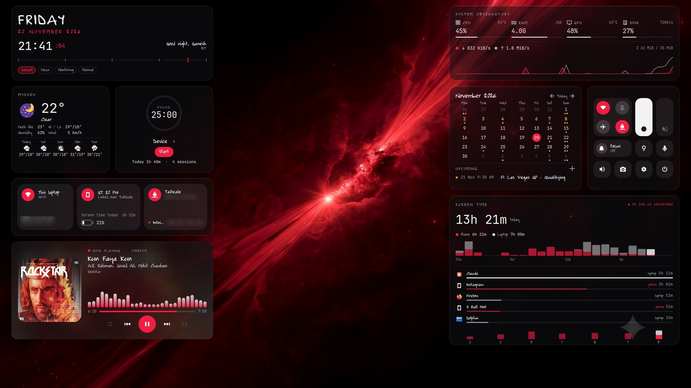
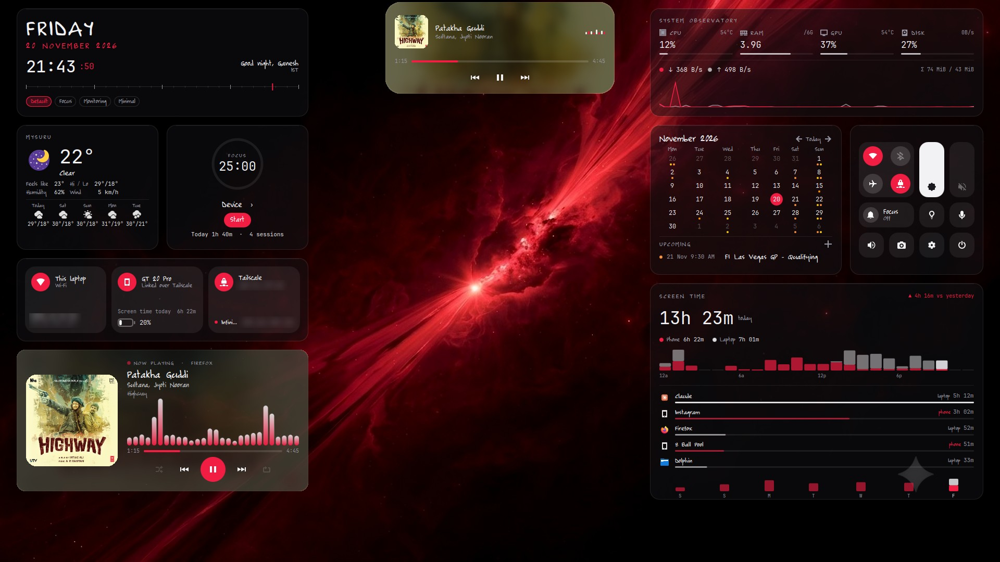
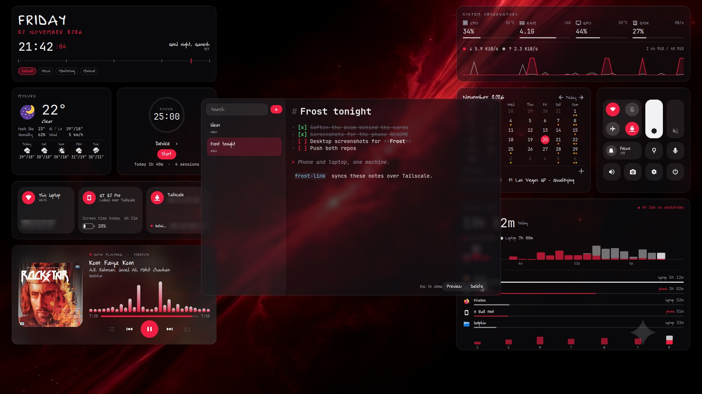
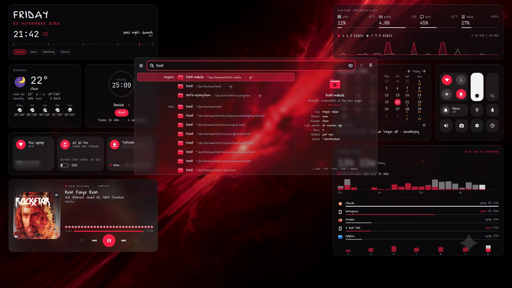

# Frost

A dark-only, glassmorphic look for KDE Plasma 6 (Wayland), plus **Obsidian Glass**:
a set of native Plasma desktop widgets, a Mac-style dock and a Dynamic Island.



| Dynamic Island | Frost Notes | Spotlight |
|:---:|:---:|:---:|
|  |  |  |

## Requirements

- KDE Plasma 6 on **Wayland** (built and tested on Plasma 6.6, Ubuntu 26.04, 1920×1080)
- PipeWire (`pactl`, `wpctl`), NetworkManager, BlueZ: the usual Plasma desktop stack
- Packages the widgets and helpers use:

  ```bash
  sudo apt install cava plocate wl-clipboard python3-pyqt6 python3-markdown python3-dbus libnotify-bin kdeconnect
  ```

- Optional: `tailscale` (Quick Controls, Device Ecosystem), `kitty` (Spotlight's terminal actions and the
  kitty theme), `gh` (GitHub search in Spotlight), VS Code (Spotlight opens projects in it),
  Papirus-Dark icons (base of the Frost icon theme)

## Install

```bash
git clone https://github.com/ganeshak11/frost.git && cd frost
sudo ./system-install.sh          # fonts (Rufscript, Inter, JetBrains Mono) and the login screen
./install.sh                      # theme, colours, window frames, effects, fonts, lock screen
widgets/install-widgets.sh        # the Obsidian Glass widgets
./desktop.sh                      # island + dock + cards; replaces the panels on your main screen
```

`install.sh` backs up your current look the first time it runs, and `desktop.sh` backs up the panel
layout every time (both in `~/.local/share/glass-theme/`). `desktop.sh` restarts plasmashell once.
Then pick whichever extras you want: each has its own script (see the table below), for example
`extras/notes/install.sh` for Frost Notes on Alt+Y and `extras/shell/install-shortcuts.sh` for
Do Not Disturb on Meta+Shift+D.

## What's here

| Path | What it does |
|---|---|
| `build.py` | Generates the theme: the Frost Dark colour scheme (red accent `#F21D43`), the glass Plasma theme (including the dock's glass bar, drawn by the bottom panel), Kvantum app styles, window decorations and global themes, into `build/` |
| `install.sh` | Builds and applies the theme for your user (fonts, effects, panels). Backs up your previous look the first time |
| `revert.sh` | Restores the look you had before Frost |
| `system-install.sh` | **sudo.** Installs Rufscript / Inter / JetBrains Mono and the Frost login screen (SDDM). `--undo` removes the login theme |
| `sddm/frost/` | The login screen theme |
| `widgets/` | The Obsidian Glass widgets (QML plasmoids) and `install-widgets.sh` |
| `widgets/shared/` | Shared design tokens (`Style.qml`) and the glass card, copied into every widget at install |
| `desktop.sh` | Sets up the whole desktop: the island at the top, the dock at the bottom (removes other panels on the main screen, with their tray and app menu) and the cards in a bento layout around the portrait. Backs up the panel config first, restarts plasmashell once |
| `splash/` | Login splash (day, date, red progress line), packaged into the global themes |
| `palette/` | `frost.toml`: the Frost colours in one place (base greys, the red accent, states, syntax colours, the 16 terminal colours). The terminal themes are generated from it, so a change here reaches every one of them on the next `extras/terminal/install.sh` |
| `extras/terminal/` | **Frost for the terminal and its tools**, all from `palette/frost.toml`: kitty, Konsole / Yakuake (glass + blur), Zellij, Neovim and Vim (transparent background, the same syntax colours as VS Code), bat and `man`, fzf, `LS_COLORS`, lsd, eza, lazygit, lazydocker, k9s, btop, bottom, yazi, ranger, nnn, fastfetch, glow, less, cava, cmus, newsboat and git. `install.sh` only touches apps that are installed and keeps what was there (`~/.local/share/glass-theme/terminal/`); `--image` adds a Frost wallpaper behind kitty and Konsole; `--revert` puts everything back |
| `extras/kitty/` | Kitty colours, glass and tabs (generated by `extras/terminal`); included from `~/.config/kitty/kitty.conf` |
| `extras/firefox/` | `userChrome.css` / `userContent.css` + `user.js` for the Firefox profile |
| `extras/system-boot.sh` | **sudo.** Plymouth boot splash and GRUB menu theme (`plymouth/`, `grub/`). `--undo` restores the previous ones |
| `extras/system-zram.sh` | **sudo.** Tunes zram (compressed swap in RAM) for a low-memory laptop: zram as big as RAM, zstd, preferred over the disk swapfile, kernel settings for zram. `--now` applies the size at once instead of at the next boot, `--undo` goes back |
| `extras/cursors/` | Frost cursor theme: `build_cursors.py` draws 23 cursors (dark body, white outline, red badges, animated red spinner) as Plasma SVG cursors + Xcursor files with 81 alias names, inheriting Breeze for the rest. `install.sh` installs to `~/.icons/Frost-cursors` and applies it; `--revert` goes back |
| `extras/icons/` | Frost icon theme: `build_icons.py` makes Frost from Papirus-Dark with ~1,400 folder icons recoloured to the Frost red; everything else is inherited from Papirus. `install.sh` installs it (also run by the main `install.sh`) |
| `extras/gtk/` | Frost for GTK 3 / GTK 4 apps: `build_gtk.py` recolours Breeze-Dark with the Frost palette and adds glass (translucent windows, header bars, sidebars, menus; rounded). `install.sh` puts it in `~/.themes/Frost`, selects it, adds the colours for libadwaita apps to `~/.config/gtk-4.0/gtk.css` and points Flatpak apps at it; `--revert` goes back |
| `extras/vscode/` | **Frost Dark** editor theme for VS Code, Cursor and Antigravity (`build_theme.py` makes a `.vsix`). `install.sh` installs it in each editor and selects it; colour overrides you had for every theme are kept, under your previous theme's name. `--revert` switches back |
| `extras/chromium/` | Frost Dark browser theme for Brave / Chrome. `install.sh` copies it to `~/.local/share/frost/chromium-theme` and prints the three clicks to load it (Chromium only takes local themes through its own page) |
| `extras/notes/` | **Frost Notes**: a global scratchpad on **Alt+Y** (same key or Esc hides it). A small background process keeps the window ready, so it appears instantly, centred, on Frost glass. Search, many notes, autosave 0.4 s after you stop typing; each note is a plain `.md` in `~/.local/share/frost-notes/` (deleted ones go to its `trash/`). Markdown is styled as you type (headings, bold, lists, `- [ ]` tasks, code, links); Enter continues lists, Ctrl+B / Ctrl+I / Ctrl+K format, Ctrl+Enter or a click ticks a task, **Ctrl+E** shows it rendered. `install.sh` sets up the command, shortcut, autostart and KWin rule; `--remove` undoes it |
| `extras/link/` | **Frost Link**: this laptop and [Frost Mobile](https://github.com/ganeshak11/frost-mobile) (the Frost launcher for Android) as one machine. A small service on port 47830 that listens only on your Tailscale address; every caller is checked with `tailscale whois`, so only your own devices are answered. It syncs Frost Notes both ways (a note changed on both keeps both copies), screen time, calendars (the phone's events in the Agenda card, this card's events in a local calendar on the phone), and battery and music both ways (play/pause/skip the laptop from the phone). No sshd, no password. `install.sh` starts it now and at login; `--remove` stops it and keeps what was synced |
| `extras/screentime/` | **Frost Screen Time** tracker for the Screen Time card: a small background process plus a KWin script that reports which app is active (only the app, never window titles). Counts seconds per app and per hour into one JSON file per day in `~/.local/share/frost/screentime/`; stops counting while the screen is locked or the laptop sleeps. `install.sh` installs and starts it (and at login); `--remove` stops it and keeps your history |
| `extras/kwin/` | `install.sh`: the Frost Alt+Tab window switcher. `better-blur.sh`: **sudo.** Builds and switches on [Better Blur DX](https://github.com/xarblu/kwin-effects-better-blur-dx), so GTK apps and their menus get real frosted glass; `--rebuild` after a Plasma update, `--off` for KWin's own blur |
| `extras/lockscreen/` | Frost lock screen (the Frost clock and a glass password card), built on Plasma's own lock screen so fingerprint, smartcard and media controls keep working. Installed by the main `install.sh`, used from the next login; `--test` shows it without locking, `--undo` goes back |
| `extras/shell/` | `frost-dnd` (toggle Do Not Disturb) with `install-shortcuts.sh` for Meta+Shift+D, and `frost-prompt.bash`, the bash prompt in Frost colours |
| `previews/` | Screenshots used as the Global Theme previews in System Settings |

## Dock and Dynamic Island

- **Dock** (bottom, hides until you push the pointer to the bottom edge): one glass bar with your apps (`org.frost.dock`) and the clipboard. There is no system tray or app menu: use KRunner (Alt+Space) to launch other apps, Quick Controls for Wi-Fi / Bluetooth / volume. Running dots (red = active app), gentle magnification, a small bounce while an app starts, a pulsing ring when one wants attention. Click to open / focus, click the active app to minimise, middle-click for a new window, right-click for New Window / Keep in Dock / Minimise / Maximise / Close, press and hold then drag to reorder. Icon size and magnification are in the widget's config (`iconSize`, `magnification`).
- **Dynamic Island** (`org.frost.island`, top centre; windows go under it): a black pill that shows what's live and morphs with a spring:
  - idle: the time, a green bolt while charging, a green dot while an app uses the camera, an orange dot while one uses the microphone, a red dot for unread notifications
  - live activities, most important first: screen recording or sharing (pulsing red dot + elapsed time), music (any MPRIS player: artwork and live beat bars), your island timer (yellow ring + countdown) or stopwatch, a file transfer (Dolphin / KIO: ring and percentage), a browser download (Firefox `.part` / Brave and Chrome `.crdownload` files in ~/Downloads: name and size), the Focus timer. With two at once the second sits in a small bubble beside the pill; camera / mic dots stay visible in the corner
  - banners: notifications (click to open, hover to keep), transfer done / failed, download finished (click to open the file) or stopped, timer done (with a sound, even in Do Not Disturb), rain expected within the hour at the Weather widget's place (Open-Meteo, at most every 2 hours), charger in / out, low battery, Bluetooth device connected / disconnected, Do Not Disturb on / off
  - charging: plugging in widens the pill into a short "Charging" bar whose green battery fills up to the current percentage
  - screenshots: a thumbnail banner after every screenshot (from Spectacle's notification, the clipboard if it only copied, or a new file in ~/Pictures/Screenshots). Drag the thumbnail into any app, click it to open, or use Copy / Show in Folder; it stays while the pointer is on it
  - click the pill (or press **Meta+Alt+I**) to expand it: full player, big focus timer, transfer with Pause / Cancel, timer with Pause / +1 min / Cancel, stopwatch with Pause / Reset, recording time, download with speed, or the overview with date, battery, devices, timer chips (1 / 5 / 10 / 25 min, a custom one you set by scrolling, Stopwatch) and your notification history (click one to open it, × to dismiss, Clear all). It closes when the pointer leaves it.
- **Spotlight** (`org.frost.spotlight`): the **Meta** key on its own opens a centred black search bar using Plasma's own search runners: apps, open windows, System Settings pages, calculator (`= 1250 * 1.18`), unit and currency conversion (`10 km in miles`), recent files and places, web shortcuts (`gg:` Google, `dd:` DuckDuckGo, `yt:` YouTube). On top of those: your projects in `~/dev` (Enter opens VS Code, Ctrl+Enter a kitty terminal there, Shift+Enter Dolphin) with branch, uncommitted changes and last commit in a preview pane; file names anywhere in your home (plocate); `> command` runs it in kitty; `gh: words` searches your GitHub repositories; `?` opens the Shortcut Sheet. Results are grouped; Up / Down to move, Enter to open, Shift+Enter for an extra action, Tab to jump to the next group, Esc to close. It's a 1 px widget beside the island in the top bar, registered as the app launcher (that's how Meta reaches it). KRunner keeps Alt+Space, Alt+F2 and Meta+Space.
- **Control Centre** (`org.frost.controlcentre`): **Meta+Alt+C**, or right-click / scroll down on the island, drops a glass panel under it: Wi-Fi and Bluetooth with their network and device lists, Tailscale, Do Not Disturb, Night Light, display / sound / microphone sliders (click Sound for outputs, inputs and per-app volume) and what's playing.
- **Shortcut Sheet** (`org.frost.shortcuts`): **Meta+/** (or `?` in Spotlight) shows every Frost, window, screenshot and app shortcut on a glass sheet, read live from your shortcut settings so it's always right. Esc closes it.
- **Do Not Disturb**: **Meta+Shift+D** toggles it from anywhere (`extras/shell/frost-dnd`; `extras/shell/install-shortcuts.sh` sets up the key). The island shows On / Off.
- **Clipboard**: the dock's clipboard icon runs Klipper, so copied text outlives the app it came from. **Meta+V** shows the history at the pointer.
- The island is the notification centre: with no system tray there's no Plasma bell and no popups of its own. If you add a tray back, untick its Notifications item (or you'll see every notification twice).

## Widgets

- **Chronos**: day, date, time with seconds, greeting, 24-hour timeline, layout profile chips (Default / Focus / Monitoring / Minimal). Click the time for 12/24-hour.
- **System Observatory**: CPU, RAM, GPU, disk and a 60-second network graph (from KDE's ksystemstats).
- **Weather Intelligence**: Open-Meteo, no account. City in the widget settings.
- **Device Ecosystem**: three glass modules in the Quick Controls style (drag files onto the phone module to send them, like AirDrop): this laptop (Wi-Fi / Ethernet, network name, local IP), your KDE Connect phone (battery capsule, send a file, ring it) and Tailscale (your address and up to three of your devices, online first). A red bubble means connected; click any address to copy it. With Frost Link (`extras/link`) the phone module also shows what the phone is playing, its screen time today, and its battery when KDE Connect isn't connected.
- **Focus**: Pomodoro with your own projects (click the project name to add, pick or remove), daily stats, optional Do Not Disturb.
- **Calendar & Agenda**: Monday-first month grid with a coloured dot per kind of event, and what's coming up. Click a day, press **+** and type `09:30 Gym`, `Gym`, or `05/03/2004 Mom's bday` (another date, e.g. a birth date, so ages are counted). Pick Once / Weekly / Monthly / Yearly and a colour (birthday pink, anniversary purple, important red); "bday" / "anniversary" pick yearly and the colour for you. Right-click one of your events to delete it. Feeds in the widget settings, one per line: `link #colour Name +Word`: Indian holidays, Real Madrid fixtures (gold) and F1 races, qualifying and sprints (orange) by default; add your Google Calendar's secret iCal address (repeating events in feeds are expanded, with their exceptions). Reminders appear in the Dynamic Island 10 minutes before and at the start of timed events, at 9:00 for all-day ones (switch off in the settings). With Frost Link, your phone's events show here too in their own colours (calendars this card already has as feeds are left out), and this card's events and feeds appear on the phone.
- **Quick Controls**: a phone-style control centre on a 4×4 grid. Round Wi-Fi / Bluetooth / Airplane / Tailscale bubbles (right-click Wi-Fi or Bluetooth for its list, click around the bubbles for all four with details), short brightness and volume faders (drag or scroll, click the speaker to mute), Focus (Do Not Disturb), Night Light, mic mute, Sound (outputs, inputs, per-app volume), region screenshot, System Settings and Power. The list pages swallow the scroll wheel so it never reaches the faders.
- **Music**: artwork (thumbnail only for videos), live beat bars from `cava` (`code/beats.py`, local only, stops when idle), progress and controls. Appears only while something plays, hides 30 s after pausing.
- **Fortis Observe** (`org.frost.observe`): today's traffic on the portfolio from the [Fortis Observe](https://github.com/Fortis-Ecosystem/FortisObserve) dashboard: people today and the change against the same part of yesterday, visits, views and bots, a 24-hour strip (humans red, bots white), the site's uptime check and the latest page views. Set the dashboard address and its read-only `WIDGET_TOKEN` in the widget settings; it refreshes every minute, click it to open the dashboard. Not placed by `desktop.sh`: add it from Add Widgets.
- **Screen Time**: today's total and the change since yesterday, a 24-hour strip (current hour in red), your top five apps with bars, and the last seven days. Needs the tracker: `extras/screentime/install.sh`. Click to refresh; it also updates every minute. Plasma on Wayland doesn't tell other programs how long you've been idle, so idle minutes before the screen locks still count. With Frost Link the card shows the phone and the laptop together: phone in red, laptop in white, top apps marked by device.

## Change and reinstall

```bash
widgets/install-widgets.sh   # after editing a widget (plasmashell loads it on its next start)
./desktop.sh                 # re-apply bars and layout (restarts plasmashell once)
./install.sh                 # after editing build.py
```

The island, Spotlight, Control Centre, Quick Controls, Device Ecosystem and Shortcut Sheet can be
tried in their own window without touching the desktop, for example
`plasmawindowed org.frost.controls frost-test:main frost-shot:/tmp/shot.png` saves a picture of it
(the `frost-test` comment near the top of each of those widgets lists what it takes).

## Uninstall

```bash
./revert.sh                       # your previous look and panel layout back
sudo ./system-install.sh --undo   # the previous login screen (fonts stay)
```

The extras that change settings undo themselves: `extras/gtk`, `extras/vscode`, `extras/kwin` and
`extras/cursors` with `--revert`, `extras/notes`, `extras/screentime` and `extras/link` with `--remove`, `extras/lockscreen`,
`extras/system-boot.sh` and `extras/system-zram.sh` with `--undo`. Your notes in
`~/.local/share/frost-notes/` and your screen-time history are never deleted.

## Licence

GPL-2.0-or-later, see [LICENSE](LICENSE).
